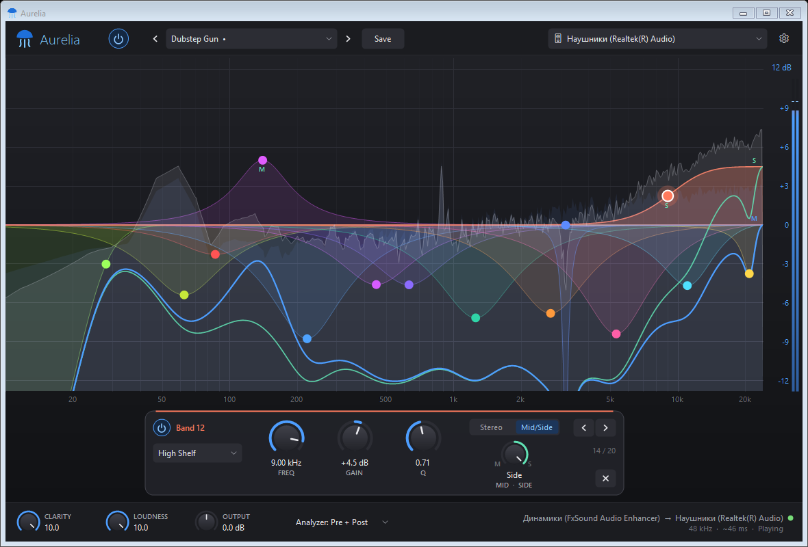

# Aurelia



Portable, system-wide 20-band parametric EQ for Windows 10/11. One exe, no installer, no runtime to install (uses the .NET Framework 4.x that ships with Windows).

## Use

Build it (see below), then run `dist\Aurelia.exe`. Settings and presets live in `Aurelia.ini` next to the exe.

- **Routing:** apps play to a virtual device (FxSound Audio Enhancer, VB-CABLE, Voicemeeter, Steam Streaming Speakers… auto-detected), which Aurelia makes the Windows default. Aurelia captures it, processes it and plays it on your real output. On exit the original default is restored.
- **EQ:** double-click to add a band (max 20). Drag nodes, use the wheel for Q, Alt+click or Del to delete. Each band has 8 shapes (bell, shelves, cuts 6–96 dB/oct, notch, band-pass, tilt), Stereo or Mid/Side placement and a Mid↔Side knob.
- **Extras:** Clarity (harmonic exciter), Loudness (dynamic boost) and Output gain, followed by a safety limiter. Pre/post spectrum analyzer and an output meter.
- **Tray:** minimize or close goes to the tray. Exit from the tray menu. "Start with Windows" (on by default) is in the ⚙ menu and launches with `--tray`.
- **Presets:** custom presets only. FxSound user presets (`%APPDATA%\FxSound\Presets\*.fac`) are imported on first run; more can be imported from the preset menu.

## Build

```
powershell -ExecutionPolicy Bypass -File build.ps1      # -> dist\Aurelia.exe
dist\Aurelia.exe --selftest                              # filters, DSP, CPU cost, WASAPI path -> Aurelia-selftest.log
```
